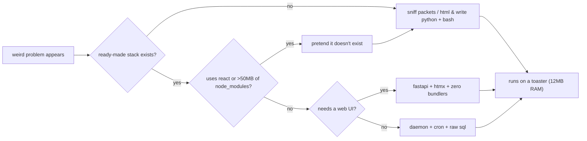

```console
$ finger berndof
Login: berndof                          Name: Bernardo
Directory: /home/berndof                Shell: /bin/zsh
Location: Florianópolis, BR (UTC-3)     Mail: /dev/null
Plan:
  broadcast infra, portals & network plumbing at @gruposcc (scc10) by day.
  agent orchestration, stubborn hardware & statistical rabbit holes by night.
  no fixed job title — i just like poking at systems until they work.
```



<div align="center">
  <picture>
    <source media="(prefers-color-scheme: dark)" srcset="https://raw.githubusercontent.com/berndof/berndof/output/noc-telemetry-dark.svg" />
    <source media="(prefers-color-scheme: light)" srcset="https://raw.githubusercontent.com/berndof/berndof/output/noc-telemetry-light.svg" />
    
  </picture>
</div>

<div align="center">
  <picture>
    <source media="(prefers-color-scheme: dark)" srcset="https://raw.githubusercontent.com/berndof/berndof/output/github-contribution-grid-snake-dark.svg" />
    <source media="(prefers-color-scheme: light)" srcset="https://raw.githubusercontent.com/berndof/berndof/output/github-contribution-grid-snake.svg" />
    
  </picture>
</div>
