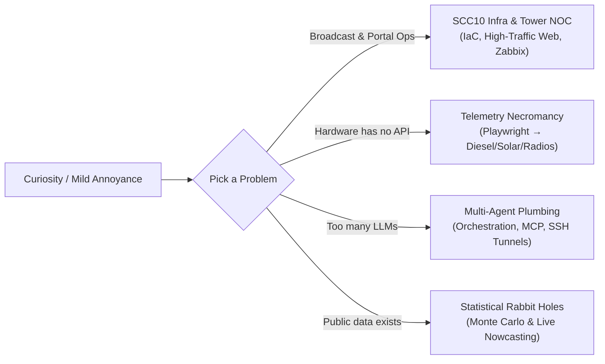

<div align="center">

# `berndof` // Bernardo

[](#)
[](#)
[](#)
[](#)
[](#)

> *"For three years this profile just said `### Hello, Wolrd! 👋` (yes, with the typo).*  
> *I eventually decided to fix the typo and document the rabbit holes instead."*

</div>

---

### `$ whoami`

No corporate buzzwords or rigid job titles here — I just like things. Specifically, I like poking at systems to see how they work, automating things that mildly annoy me, keeping high-traffic portals and broadcast infrastructure alive, orchestrating AI agents until they audit each other, running 30,000 Monte Carlo simulations to answer a weekend question, and coaxing industrial hardware into talking to monitoring servers.

*(Most of my day-to-day production code lives behind private organization doors at [**@gruposcc**](https://github.com/gruposcc) / **SCC10**; my public repositories are just the chaotic laboratory that escaped into the wild.)*



---

### `$ cat /var/log/what-i-actually-do.log`

#### 📡 Broadcast Infra, Tower NOC & High-Traffic Portals (`@gruposcc` / SCC10)
Keeping media, radio/TV transmission towers, and news portal infrastructure running smoothly — especially when traffic spikes or hardware decides to be dramatic:
* **High-Traffic Portal Infrastructure (`scc10.com.br`)**: Infrastructure-as-Code state snapshots, automated `prod ↔ dev` drift auditing, Apache / PHP-FPM / MariaDB resilience tuning, Caddy reverse proxies, local Docker parity stacks, and one-command rollbacks.
* **Live Election & High-Concurrency Systems**: Real-time vote-counting monitors, custom WordPress/PHP telemetry integrations, and data feeds built to survive election-night traffic without melting the database.
* **Hardware & NOC Necromancy**: When transmission tower radios, **Deep Sea Electronics (DSE855)** diesel generator controllers, or **Huawei FusionSolar** inverters refuse to expose a civilized API, I write headless Playwright + async Python pipelines to scrape their telemetry and pipe everything straight into **Zabbix**.

#### 🤖 Autonomous AI Agent Plumbing & Remote Dev Tooling
Building the scaffolding around CLI coding agents so they actually finish engineering tasks instead of burning tokens in an infinite loop:
* **Multi-Agent Orchestration**: Enforcing structured `recon → design → implement → verify` loops with strict MCP tool isolation, hierarchical memory spines, and TUI planning panels — because one LLM hallucinating is a bug, while five specialized agents cross-checking each other is *architecture*.
* **LLM Bridges & Observability**: Custom `stream-json` providers bridging local CLI ecosystems, quota-aware multi-provider gateways, and telemetry dashboards tracking whether agents are actually productive (Ideation-to-Execution Ratio, Plan Completion Rate, token/cost distribution).
* **Potato-Safe Remote Development**: Automated SSH tunnel managers, daemon health probes, and low-resource SSHFS kernel-cache mounts so heavy AI tooling can work against lightweight remote servers without frying their CPU or RAM.

#### 🎲 Statistical Rabbit Holes & Over-Engineered Math
* **Nowcasting & Monte Carlo Ensembles**: Turning messy public datasets (TSE, IBGE, polling history) into real-time partial-count nowcasting models, institute bias diagnostics, and 30,000-simulation Monte Carlo ensembles — complete with historical backtesting and bilingual technical write-ups.
* **Zero-Bundler Web Tooling**: Building reactive internal tools and web apps with **FastAPI + HTMX + Jinja2 fragments + asyncpg** whenever a problem doesn't justify downloading 400 MB of `node_modules`.

---

### `$ cat /proc/berndof/toolbox`

```text
LANGUAGES   :: Python (3.13/3.14, asyncio, uv) • TypeScript (Bun / Node) • Bash • PHP • SQL
INFRA / NOC :: Linux • Docker • Zabbix Telemetry • Apache / PHP-FPM / Caddy • SSH / SSHFS
AI / AGENTS :: OpenCode • Multi-Agent Orchestration • MCP • LLM Gateways • Stream Protocols
DATA / MATH :: Monte Carlo Simulation • Bayesian/Structural Nowcasting • NumPy • Pandas
WEB / AUTO  :: FastAPI • HTMX • WordPress Core/Infra • PostgreSQL / MariaDB • Playwright
```

---

### `$ watch -n 1 "git log --graph"`

<div align="center">
  <picture>
    <source media="(prefers-color-scheme: dark)" srcset="https://raw.githubusercontent.com/berndof/berndof/output/github-contribution-grid-snake-dark.svg" />
    <source media="(prefers-color-scheme: light)" srcset="https://raw.githubusercontent.com/berndof/berndof/output/github-contribution-grid-snake.svg" />
    
  </picture>
</div>

---

<details>
<summary><b>🔧 Run System Diagnostics (<code>systemctl status berndof.service</code>)</b></summary>
<br/>

```ini
● berndof.service - Curiosity-Driven Engineering & NOC Daemon
     Loaded: loaded (/etc/systemd/system/berndof.service; enabled; preset: chaotic-good)
     Active: active (running) since 2023-03-26 17:08:45 UTC; 3 years 6 months ago
   Main PID: 1337 (tinkerer)
      Tasks: 42 (limit: ∞)
     Memory: 80% in @gruposcc private repos, 20% chaotic public experiments
        CPU: 100% whenever someone says "that hardware doesn't have an API"

Oct 15 13:30:00 host berndof[1337]: [INFO] Fixed 3-year-old "Hello, Wolrd!" typo in README.md
Oct 15 13:31:12 host berndof[1337]: [OK]   Audited prod <-> dev drift on SCC10 infrastructure
Oct 15 13:32:45 host berndof[1337]: [WARN] Started 30,000 Monte Carlo simulations just to verify a hunch
Oct 15 13:34:19 host berndof[1337]: [OK]   Spawned 5 AI subagents to over-engineer a shell workflow
Oct 15 13:35:01 host berndof[1337]: [INFO] Diesel generator & radio tower telemetry coerced into Zabbix
```

</details>
