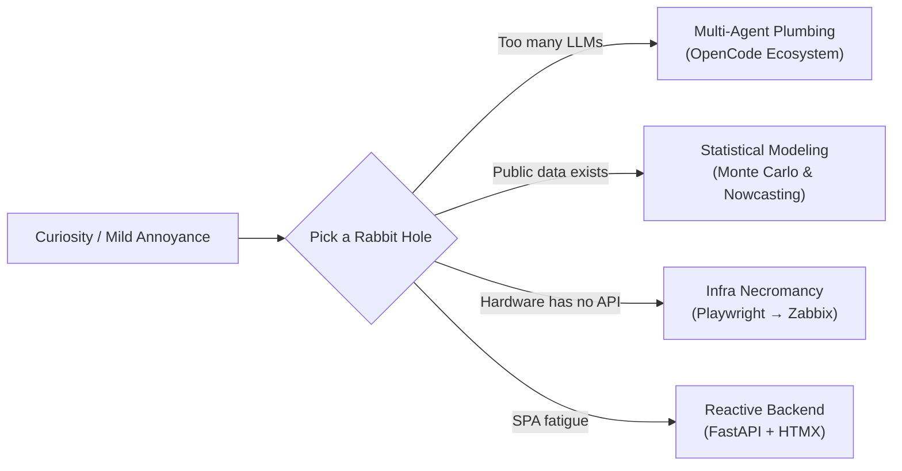

<div align="center">

# `berndof` // Bernardo

[](#)
[](#)
[](#)
[](#)

> *"For three years this profile just said `### Hello, Wolrd! 👋` (yes, with the typo).*  
> *I eventually decided to fix the typo and document the rabbit holes instead."*

</div>

---

### `$ whoami`

No corporate buzzwords or job titles here — I just like things. Specifically, I like poking at systems to see how they work, automating things that mildly annoy me, orchestrating AI agents until they cross-check each other, running 30,000 Monte Carlo simulations to answer a weekend question, and coaxing industrial hardware into talking to monitoring servers.



---

### `$ ls -lh ~/rabbit-holes/`

#### 🤖 AI Agent Plumbing & The OpenCode Ecosystem
Building infrastructure around autonomous coding agents so they actually finish tasks instead of just burning tokens in a loop:

| Repository | What it actually does | Stack |
| :--- | :--- | :--- |
| [**`opencode-orchestrator`**](https://github.com/berndof/opencode-orchestrator) | Production-grade multi-agent orchestration suite enforcing a `recon → design → implement → verify` loop, strict MCP tool isolation, an opt-in TUI plan panel, and a 2-level hierarchical memory spine. Because one LLM hallucinating is a bug, but five agents auditing each other is *architecture*. | `TypeScript` `MCP` `Agents` |
| [**`opencode-remote`**](https://github.com/berndof/opencode-remote) | Seamless remote development over SSH (`ocd connect`). Handles daemon health probes, port-collision-aware SSH tunnels, TUI auth injection, and automatic SSHFS fallback with a low-resource kernel cache guard when the remote box is a potato. | `Python` `SSHFS` `TUI` |
| [**`opencode-agy-bridge`**](https://github.com/berndof/opencode-agy-bridge) | Custom `LanguageModelV3` provider for OpenCode 2.x that routes LLM calls directly into Google's Antigravity CLI (`agy`) over persistent `stream-json` pipes. | `TypeScript` `AI SDK` |
| [**`opencode-system-analytics`**](https://github.com/berndof/opencode-system-analytics) | System-wide observability & telemetry dashboard for multi-agent runs. Computes Ideation-to-Execution Ratio (IER), Plan Completion Rate (PCR), Practical Actionability Index (PAI), and per-agent token/cost distribution. | `Python` `Telemetry` |
| [**`OmniRoute`**](https://github.com/berndof/OmniRoute) | Unified AI gateway with quota-aware fallback, token compression, and multi-provider routing across CLI coding tools. *(Fork / Active Setup)* | `TypeScript` `LLM Gateway` |

#### 🎲 Statistical Rabbit Holes & Over-Engineered Math

| Repository | What it actually does | Stack |
| :--- | :--- | :--- |
| [**`eleicao-2026`**](https://github.com/berndof/eleicao-2026) | End-to-end statistical modeling pipeline for the 2026 Brazilian presidential election (PT/EN). Combines real-time 1st-round partial-count nowcasting (**0.2 pp** backtest error at 85% counted; 28/28 states called), institute bias diagnostics, and a **30,000-run Monte Carlo ensemble** across 3 independent models. | `Python` `Monte Carlo` `Data Science` |

#### 🔌 Hardware Telemetry, Scrapers & Web Stack
When an industrial controller or solar inverter refuses to expose a clean API, or when a web app doesn't need 400 MB of `node_modules`:

| Repository | What it actually does | Stack |
| :--- | :--- | :--- |
| [**`fasthtmx`**](https://github.com/berndof/fasthtmx) | Modern async Python web stack pairing **FastAPI + HTMX + Jinja2 fragments + asyncpg + Alembic** for reactive UIs without frontend bundler existential dread. | `Python 3.14` `FastAPI` `HTMX` |
| [**`dse855-scraper`**](https://github.com/berndof/dse855-scraper) | Async Playwright scraper & Zabbix sender that extracts live telemetry from **Deep Sea Electronics (DSE855)** diesel generator controllers. | `Python` `Playwright` `Zabbix` |
| [**`fusion_solar_scraper`**](https://github.com/berndof/fusion_solar_scraper) | Automated collector that pulls inverter metrics from **Huawei FusionSolar** portals and pipes them straight into Zabbix via `zabbix_sender`. | `Python` `Playwright` `Zabbix` |

---

### `$ cat /proc/berndof/toolbox`

```text
LANGUAGES   :: Python (3.13/3.14, asyncio, uv) • TypeScript (Bun / Node) • SQL • Bash
AI / AGENTS :: OpenCode • Multi-Agent Orchestration • MCP • LLM Gateways • Stream Protocols
DATA / MATH :: Monte Carlo Simulation • Bayesian/Structural Nowcasting • NumPy • Pandas
WEB / DB    :: FastAPI • HTMX • Jinja2 Fragments • PostgreSQL (asyncpg) • SQLite • Alembic
INFRA / OPS :: Linux • SSH / SSHFS Tunnels • Zabbix Telemetry • Playwright • Docker • Git
```

---

<details>
<summary><b>🔧 Run System Diagnostics (<code>systemctl status berndof.service</code>)</b></summary>
<br/>

```ini
● berndof.service - Curiosity-Driven Engineering Daemon
     Loaded: loaded (/etc/systemd/system/berndof.service; enabled; preset: chaotic-good)
     Active: active (running) since 2023-03-26 17:08:45 UTC; 3 years 6 months ago
   Main PID: 1337 (tinkerer)
      Tasks: 42 (limit: ∞)
     Memory: 94% occupied by side projects
        CPU: 100% whenever someone says "that can't be automated"

Oct 15 13:30:00 host berndof[1337]: [INFO] Fixed 3-year-old "Hello, Wolrd!" typo in README.md
Oct 15 13:31:12 host berndof[1337]: [OK]   Spawned 5 subagents to over-engineer a shell workflow
Oct 15 13:32:45 host berndof[1337]: [WARN] Started 30,000 Monte Carlo simulations just to verify a hunch
Oct 15 13:35:01 host berndof[1337]: [INFO] Diesel generator telemetry successfully coerced into Zabbix
```

</details>
