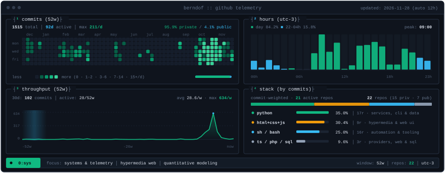

```console
$ finger berndof
Login: berndof                          Name: Bernardo
Location: Florianópolis, BR (UTC-3)     Shell: /bin/zsh
Plan:
  systems engineering, infrastructure telemetry, and web tooling.
  mostly python, shell, sql, and server-rendered web interfaces.
  focused on small, reliable software with minimal moving parts.
```

| Repository | Area | Description |
| :--- | :--- | :--- |
| [`dotfiles`](https://github.com/berndof/dotfiles) | Environment | Declarative Zsh and terminal setup with explicit sync CLI |
| [`dse855-scraper`](https://github.com/berndof/dse855-scraper) | Telemetry | Async telemetry collector for DSE855 generator controllers to Zabbix |
| [`eleicao-2026`](https://github.com/berndof/eleicao-2026) | Modeling | Electoral forecasting pipeline, backtests, and bilingual analysis |
| [`fasthtmx`](https://github.com/berndof/fasthtmx) | Web | Explicit async hypermedia stack on FastAPI, HTMX 2, and SQLAlchemy |
| [`fusion-solar-scraper`](https://github.com/berndof/fusion-solar-scraper) | Telemetry | Headless collector for Huawei FusionSolar inverters to Zabbix |

<div align="center">
  <picture>
    <source media="(prefers-color-scheme: dark)" srcset="https://raw.githubusercontent.com/berndof/berndof/output/noc-telemetry-dark.svg" />
    <source media="(prefers-color-scheme: light)" srcset="https://raw.githubusercontent.com/berndof/berndof/output/noc-telemetry-light.svg" />
    
  </picture>
</div>
